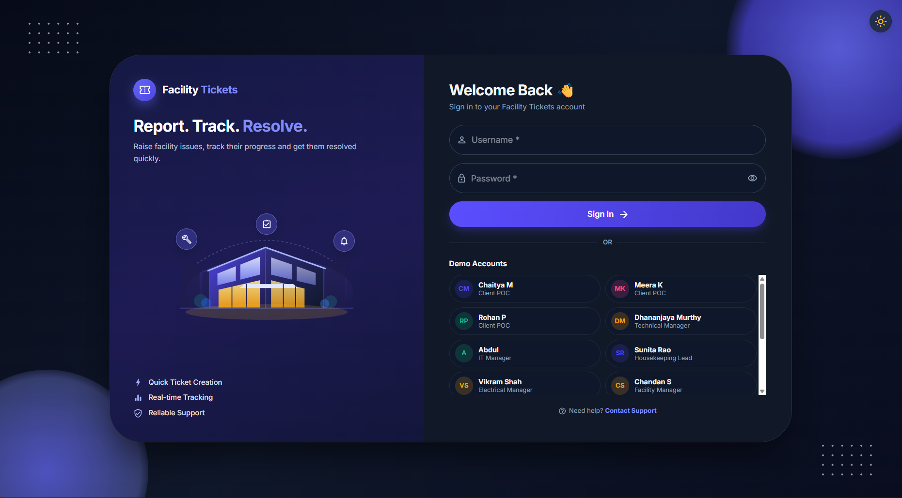
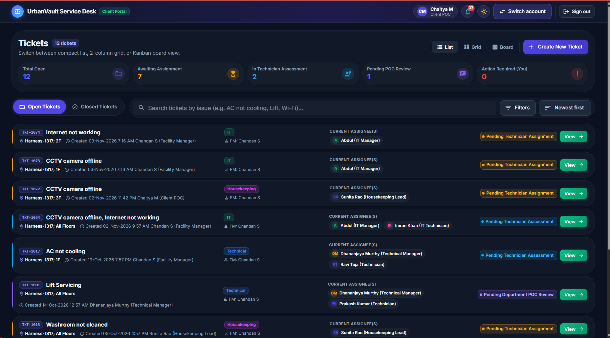
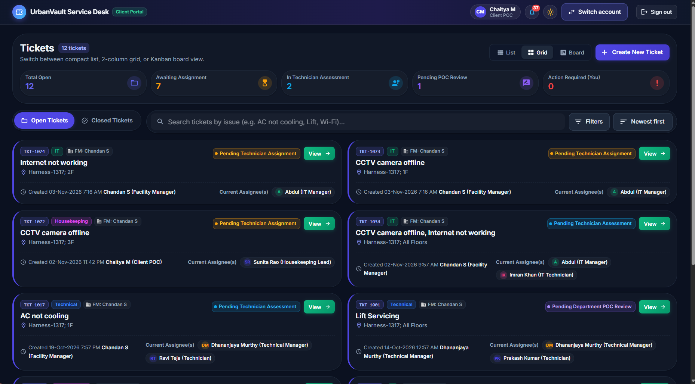
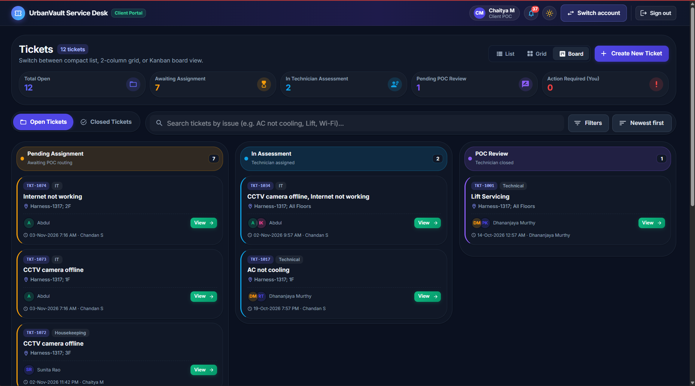
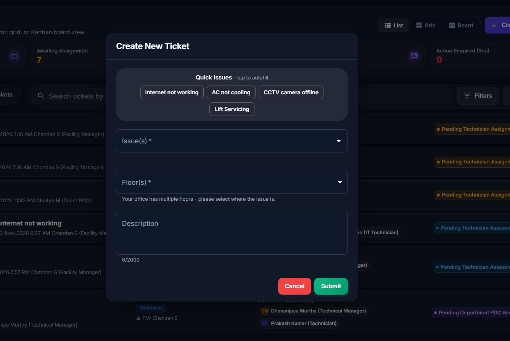
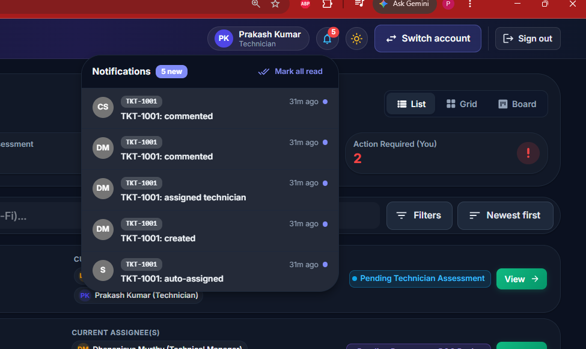
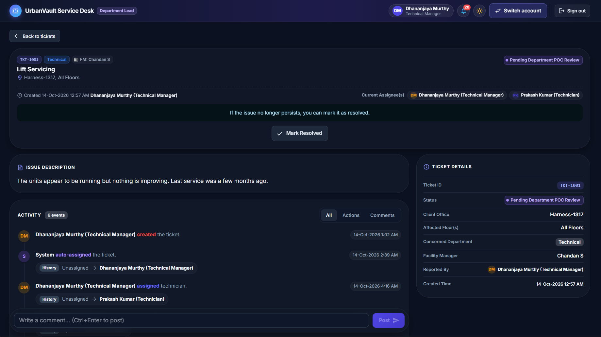
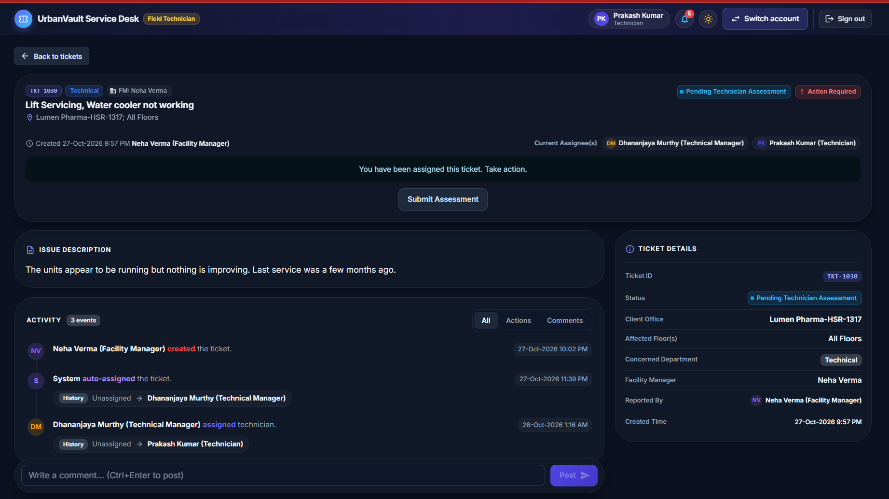
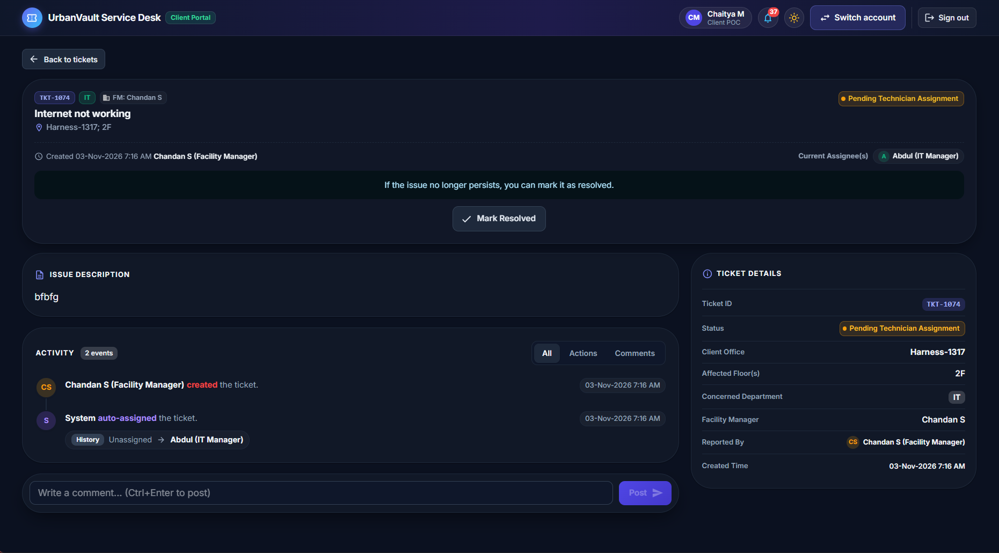
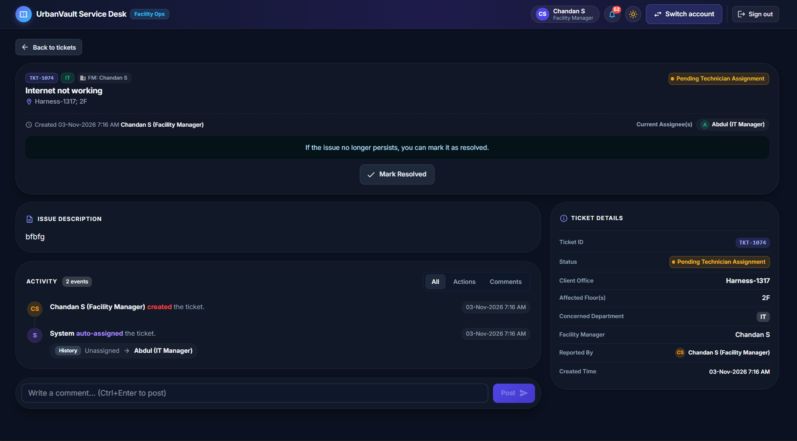

# Facility Ticketing App

Full-stack take-home: a role-based facility ticketing system (React + Material UI, Django REST Framework, PostgreSQL, Redis, Celery).

It implements the wireframe's two flows - **1. Ticket Creation** and **2. Ticket Handling** (first two handling steps) - for four seeded roles: **Client**, **Facility Manager**, **Department POC** and **Worker/Technician**.

## Contents
1. [Application screenshots](#application-screenshots)
2. [Local development with Docker (Recommended)](#local-development-with-docker-recommended)
3. [Local development without Docker](#local-development-without-docker)
4. [Tests](#tests)
5. [Seeded accounts](#seeded-accounts)
6. [Functional overview and wireframe mapping](#functional-overview-and-wireframe-mapping)
7. [API endpoints](#api-endpoints)
8. [Data model](#data-model)
9. [Architecture decisions](#architecture-decisions)
10. [Engineering depth items](#engineering-depth-items-all-four-implemented)
11. [Celery and Redis design](#celery-and-redis-design)
12. [Assumptions](#assumptions)
13. [Limitations and what I would improve](#limitations-and-what-i-would-improve)
14. [AWS deployment note](#aws-deployment-note)

---

## Application screenshots

### 1. Authentication & Quick Demo Role Switcher
Split-screen login with one-click demo account cards grouped by role (**Client**, **Facility Manager**, **Department POC**, and **Worker/Technician**), performing real JWT authentication (`POST /api/auth/token/`).



---

### 2. Ticket Dashboard — 3 Layout Views (List, 2-Column Grid, 4-Column Kanban Board)
Real-time KPI summary strip, Open/Closed tabs, debounced issue search, role-scoped filters (Client, Department, Facility Manager, Status), sorting, and URL-synced view switcher.

#### List View


#### 2-Column Grid View & 4-Column Status Kanban Board
| 2-Column Grid View | 4-Column Kanban Board View |
|---|---|
|  |  |

---

### 3. Flow 1: Ticket Creation & Async Celery Notifications
* **Create New Ticket Modal**: Dynamic **Quick Issues** aggregated from the client's historical tickets, single-department issue validation, multi-floor selection (with *All Floors* toggle), and duplicate-submission guard.
* **Live Notification Bell**: Displays asynchronous notifications processed by the **Celery + Redis** worker with unread count badge, *Mark all read*, and one-click navigation to the ticket.

| Create New Ticket Modal | Celery Worker Notification Bell |
|---|---|
|  |  |

---

### 4. Flow 2: Role-Based Ticket Handling Workspace (All 4 Roles)
2-column Jira-style workspace with the issue description, tabbed audit/comment timeline, and sticky comment composer on the left, paired with a role-specific workflow action panel on the right:

| Department POC View (*Assign Worker* / *Change Department*) | Field Technician / Worker View (*Submit Assessment*) |
|---|---|
|  |  |

| Client View (*Mark Resolved* CTA) | Facility Manager View (*Property Oversight & Comments*) |
|---|---|
|  |  |

---

## Local development with Docker (Recommended)

Prerequisites: **Docker Desktop** (with Docker Compose v2) and **Git**.

### 1. Clone the repository & configure environment variables
Copy the example environment file (it already contains working local defaults so `docker compose up --build` works immediately after copying, or you can customize the values):

```bash
git clone <repository-url>
cd Ticketing-App

# macOS / Linux
cp .env.example .env

# Windows PowerShell
Copy-Item .env.example .env
```

Key variables in `.env`:
* `POSTGRES_DB`, `POSTGRES_USER`, `POSTGRES_PASSWORD` — PostgreSQL 16 database credentials
* `DJANGO_SECRET_KEY` — Django signing key
* `DEMO_MODE=true` & `DEMO_PASSWORD` — Password assigned to all 14 seeded demo users and enables the in-app Account Switcher
* `SEED_ON_START=1` — Automatically runs migrations and seeds demo data when the `web` container starts

### 2. Build and start all 5 containers
```bash
# Start in the foreground (streams logs from all services)
docker compose up --build

# Or start in detached (background) mode
docker compose up -d --build
```

Docker Compose starts 5 services in dependency order (with health checks on PostgreSQL and Redis):
1. `db` — **PostgreSQL 16** (`postgres:16-alpine`) with persistent named volume `pgdata`
2. `redis` — **Redis 7** (`redis:7-alpine`) broker and result backend
3. `web` — **Django 5.2 + Gunicorn** API server (automatically runs `migrate` and `seed_demo` on startup)
4. `worker` — **Celery 5.4 worker** processing asynchronous ticket notifications
5. `frontend` — **React 18 + Vite** production build served by **Nginx** (proxies `/api/*` and `/admin/*` to `web:8000`)

### 3. Access the application
| Service | URL |
|---|---|
| **Frontend Web App** (Nginx -> React SPA, proxies `/api`) | http://localhost:3000 |
| **Backend REST API** (Django / Gunicorn) | http://localhost:8000/api/ |
| **API Health Check** | http://localhost:8000/api/health/ |
| **Django Admin** | http://localhost:8000/admin/ |

### 4. Useful Docker development commands
```bash
# Check container health and status
docker compose ps

# Follow live logs (all services, or just web / worker)
docker compose logs -f
docker compose logs -f web worker

# Re-seed demo data from scratch (resets tickets and users)
docker compose exec web python manage.py seed_demo --reset

# Run database migrations manually after model changes
docker compose exec web python manage.py makemigrations
docker compose exec web python manage.py migrate

# Create a Django Admin superuser (Note: set role='FACILITY_MANAGER' or 'CLIENT')
docker compose exec web python manage.py createsuperuser

# Rebuild and restart a specific service after code changes
docker compose up -d --build frontend
docker compose up -d --build web worker

# Stop containers (preserves database volume)
docker compose down

# Stop containers and wipe database volume for a clean slate
docker compose down -v
```

`.env.example` contains placeholders only — no real credentials or `.env` files are committed to the repository.

## Local development without Docker

Backend (Python 3.12):

```bash
cd Backend
python -m venv .venv && source .venv/bin/activate      # Windows: .venv\Scripts\activate
pip install -r requirements.txt

# Option A - PostgreSQL + Redis running locally (matches production):
export DJANGO_DEBUG=true POSTGRES_HOST=localhost POSTGRES_PASSWORD=... DEMO_MODE=true
# Option B - zero-dependency quick look (SQLite, tasks run inline, no Redis):
export DJANGO_DEBUG=true USE_SQLITE=1 CELERY_EAGER=1 DEMO_MODE=true

python manage.py migrate
python manage.py seed_demo
python manage.py runserver                # http://localhost:8000
celery -A config worker -l info           # Option A only
```

Frontend (Node 20+):

```bash
cd Frontend
npm install
npm run dev                               # http://localhost:5173 (proxies /api to :8000)
```

Windows PowerShell: use `$env:NAME="value"` instead of `export`.

## Tests

```bash
# Backend (18 tests) - SQLite + eager Celery so no services are required
cd Backend
USE_SQLITE=1 DJANGO_DEBUG=true CELERY_EAGER=1 python manage.py test tickets.tests
# Same suite against PostgreSQL/Redis (inside compose):
docker compose exec web python manage.py test tickets.tests

# Frontend (5 tests, Vitest + Testing Library)
cd Frontend && npm test
```

| Requirement | Where |
|---|---|
| API flow / business rule / invalid transition | `tickets/tests/test_workflow.py` (create -> assign -> assess -> resolve, 409 on repeated/invalid transitions, 400 validation, pagination/search/filter/sort, query count) |
| Authentication / authorization | `tickets/tests/test_auth_permissions.py` (401, JWT login, per-role visibility, 403 for actions, cross-client/department isolation) |
| Celery task incl. failure / retry & notifications API | `tickets/tests/test_tasks.py` (idempotent re-run, transient failure retried and delivered once, permanent failure after max retries, missing activity, `/api/notifications/` list & mark-read) |
| Frontend component / interaction | `CreateTicketDialog.test.jsx` (validation, quick-issue autofill, **double-click submits once**), `TicketCard.test.jsx` (card fields, activity filtering) |

## Seeded accounts

All seeded users share the password in `DEMO_PASSWORD` (`.env`). Registration / password reset / user management are intentionally not built.

| Username | Person | Role |
|---|---|---|
| `chaitya` | Chaitya M | Client (Harness) |
| `meera` | Meera K | Client mapped to **two** clients (Orion Labs, Zenith Foods) - shows the Client picker |
| `rohan` | Rohan P | Client (Lumen Pharma) |
| `chandan` | Chandan S | Facility Manager (Harness Tech Park) |
| `neha` | Neha Verma | Facility Manager (HSR Business Centre) |
| `dhananjaya` | Dhananjaya Murthy | Department POC - Technical |
| `abdul` | Abdul | Department POC - IT |
| `sunita`, `vikram` | | POCs - Housekeeping, Electrical |
| `prakash`, `ravi` | Prakash Kumar, Ravi Teja | Workers - Technical |
| `imran`, `lakshmi`, `mohan` | | Workers - IT, Housekeeping, Electrical |

**Switching accounts** - the login page lists the seeded users, and the app bar has a *Switch account* menu. Each switch is a normal username/password JWT login (`POST /api/auth/token/`) using the demo password; there is no impersonation or auth bypass. The list and password are only exposed by `GET /api/auth/demo-accounts/` when `DEMO_MODE=true` (set it to `false` anywhere real).

## Functional overview and wireframe mapping

| Wireframe | Implementation |
|---|---|
| Ticket list with **Open / Closed** tabs, search bar, Filters, Sort, card with title, `Client-Office; floors`, ticket id, status, created-by, current assignee(s), *Action Required*, **View** | `TicketListPage`, `TicketFilters`, `TicketCard`, `TicketBoard` - KPI summary strip, 3 view modes (**List / 2-Col Grid / 4-Col Kanban Board**), all state in the URL, server-side pagination (10/page), search (issue text), filters (client, department, facility manager, status), sort (newest / oldest first) |
| **Create New Ticket** form (Client\*, Quick Issues, Issue(s)\* multi-select, Floor(s)\*, Description) | `CreateTicketDialog`. *Client* is shown only when the user can create for more than one client. *Floors* only when the office has several floors (single-floor offices are auto-filled). Quick Issues come from the client's own ticket history (aggregation), padded with globally popular issues for new clients |
| Created by **Client** or **UV internal employees** (Facility Manager / Department POC) | Clients: own clients. FM: clients of the properties they manage. POC: any client. Workers cannot create (403) |
| Ticket **auto-assigned** to the issue's Department POC; "Unassigned -> POC" history | `services.create_ticket` writes `CREATED` and `AUTO_ASSIGNED` (actor *System*) activities |
| Detail view: sticky summary + CTA on top, Issue Description, Activity (All / Actions / Comments, event count, History `from -> to`), sticky comment box at the bottom | `TicketDetailPage`, `ActivityTimeline`, `CommentComposer` - 2-column Jira-style layout on desktop (scrollable issue & activity feed on left, sticky workflow action & people sidebar on right), stacked on mobile |
| **POC CTAs**: *Assign Worker* (select worker) / *Change Department* (department + forwarding note) | `ActionPanel` -> `POST .../assign-worker/`, `.../change-department/` |
| **Worker CTA**: *Submit Assessment* -> Fully Resolved / Partially Resolved / Suggest Department-Worker Change | `ActionPanel` -> `POST .../submit-assessment/` (note required for the last two) |
| **Client CTA**: *Mark Resolved* | `POST .../resolve/` (confirmation dialog) |
| FM: no CTA, read-only + comments | `available_actions` is just `["comment"]` |
| Status labels: *Pending Technician Assignment -> Pending Technician Assessment -> Pending Department POC Review* | `Ticket.Status` |
| Visibility: Client = own clients, FM = their property, POC = their department, Worker = assigned to them; "new POC starts seeing the ticket" after Change Department | `services.visible_tickets` (applied to every endpoint, not only the list) |

### Status machine

```
PENDING_ASSIGNMENT --assign worker----------> PENDING_ASSESSMENT
PENDING_ASSIGNMENT --change department------> PENDING_ASSIGNMENT  (new POC)
PENDING_ASSESSMENT --submit assessment------> PENDING_POC_REVIEW   ("Technician Closed")
any open status    --resolve (client/creator)-> RESOLVED
```
Anything else is rejected with **409 `invalid_transition`**; a user who isn't allowed to perform an action gets **403**; a user who can't see the ticket gets **404**.

## API endpoints

Base path `/api`. JWT bearer auth (`Authorization: Bearer <access>`).

| Method & path | Purpose |
|---|---|
| `POST /auth/token/` / `POST /auth/refresh/` | Login (username + password) / refresh token |
| `GET /auth/me/` | Current user (role, department, `can_create_ticket`) |
| `GET /auth/demo-accounts/` | Seeded accounts for the switcher (only when `DEMO_MODE=true`) |
| `GET /health/` | Health probe (DB check) |
| `GET /tickets/` | Paginated list. Query: `tab=open\|closed`, `search`, `client`, `department`, `facility_manager`, `status`, `ordering=created_at\|-created_at`, `page`, `page_size` (max 50) |
| `POST /tickets/` | Create `{client?, issues[], floors[], description?}` |
| `GET /tickets/{id}/` | Detail incl. issues, activity log and `available_actions` |
| `POST /tickets/{id}/assign-worker/` | `{worker}` - POC of the ticket's department |
| `POST /tickets/{id}/change-department/` | `{department, note}` - POC of the ticket's department |
| `POST /tickets/{id}/submit-assessment/` | `{outcome: FULLY_RESOLVED\|PARTIALLY_RESOLVED\|SUGGEST_CHANGE, note?}` - assigned worker |
| `POST /tickets/{id}/resolve/` | Creator / client member |
| `POST /tickets/{id}/comments/` | `{text}` (<= 2000 chars) |
| `GET /notifications/` | Latest 30 delivered notifications (`results`) + `unread_count` for the signed-in user |
| `POST /notifications/mark-read/` | `{id?}` - Mark a single notification or all unread notifications as read |
| `GET /ticket-filters/` | Filter options limited to what the user can see |
| `GET /clients/`, `/clients/{id}/quick-issues/`, `/issues/`, `/departments/`, `/facility-managers/`, `/workers/` | Lookups |

List response: `{"count", "next", "previous", "results": [...]}`.

**Error envelope (all errors):**
```json
{ "error": { "code": "validation_error", "message": "Please correct the highlighted fields.", "details": { "floors": ["Select at least one floor."] } } }
```
Codes: `validation_error` (400), `not_authenticated`/`authentication_failed` (401), `permission_denied` (403), `not_found` (404), `invalid_transition` (409), `server_error` (500, no internals leaked).

## Data model

```
Building(Property) 1--* Client 1--* Floor           Department 1--* Issue
   |facility_manager                                 |poc
   v                                                 v
 User(role, designation, department?, clients M2M) <-+

Ticket(client, department, issues M2M, floors M2M, status, created_by, assigned_poc, assigned_worker, ...)
   1--* TicketActivity(actor?, type, from_value, to_value, message)   <- audit trail + comments
   1--* Notification(recipient, activity, idempotency_key UNIQUE)     <- async pipeline output
```

* One custom `User` with a `role`; Client users map to Clients via M2M (a user can belong to several).
* **Constraints**: `CheckConstraint`s on ticket status, "pending-assignment tickets have no worker", "resolved tickets have `resolved_at`", "POC/Worker users require a department"; uniqueness of client office, floor per client, issue per department, notification idempotency key.
* **Indexes** (justified by the access patterns):
  * `ticket(status, -created_at)` - every list is `WHERE status [!=] RESOLVED ORDER BY created_at`; the index serves tab + sort.
  * `ticket(department, status)` - POC visibility (`department = X`) plus tab.
  * `ticket(client, -created_at)` - client / FM visibility joins and the Client filter.
  * `ticketactivity(ticket, created_at)` - timeline is always one ticket in time order.
* `Ticket.issue_text` is a denormalised comma-joined copy of issue names so *search by issue text* is a single-table `ILIKE` rather than an M2M join + `DISTINCT`. On PostgreSQL at larger scale I would add a `pg_trgm` GIN index (see improvements).

## Architecture decisions

* **Service layer (`tickets/services.py`)** owns every business rule (visibility, permission, state machine). Views/serializers stay thin; the same `available_actions()` function drives the API's permission checks **and** the UI buttons, so they can't drift. Hiding a button is never the only protection: each endpoint re-checks (403 / 409).
* **Visibility in the queryset**, so detail and action endpoints get row-level security for free (unauthorised ticket => 404, no existence leak).
* **Race safety**: each state change runs in `transaction.atomic()` with `select_for_update(of=("self",))`, so two concurrent "assign worker" calls can't both succeed - the second sees the new state and gets 409.
* **JWT (simplejwt)** - standard auth with refresh; the SPA stores tokens in `localStorage` (trade-off noted below) and refreshes on 401 once.
* **Frontend**: Vite + React 18 + MUI 6, feature folders (`features/auth`, `features/tickets`), Light & Dark theme toggle (`ColorModeProvider` persisted in `localStorage`), in-app `NotificationBell` popover backed by Celery worker outputs, TanStack Query for server state (cache, de-duplication, `keepPreviousData` pagination, mutations write the response straight into the cache so there is no refetch after an action), URL query string as the single source of truth for tab/search/filters/sort/page (shareable, back-button friendly, predictable). Search is debounced (400 ms). Components that matter are memoised (`TicketCard`).
* **Duplicate-submission protection**: `LoadingButton` (disabled + spinner + `aria-busy`) **and** `useSubmitGuard` (a ref flipped synchronously so even a same-frame double-click is ignored). Covered by a test.
* **States handled**: loading skeletons/spinners, empty (with/without filters, per tab), success toasts + inline banners, field-level validation from both client and server error envelopes, 401 -> re-login, 403/404 friendly panels, network/5xx with *Retry*.
* **Accessibility / responsive**: semantic landmarks (`header`, `main`, `section`, `article`, ordered activity list, `time`), skip link, labelled controls, `aria-live` regions for results, `role="alert"` errors, keyboard-operable menus/dialogs; layouts reflow to mobile (full-screen create dialog, stacked filters, icon-only app-bar buttons, sticky regions sized for small screens).

## Engineering depth items (all four implemented)

1. **Audit history** - `TicketActivity` is an append-only log (type, actor or *System*, `from -> to`, message, timestamp), written in the same transaction as the change. It powers the Activity section.
2. **Transactions** - ticket create (ticket + M2M + 2 activities), assign worker, change department, assessment, resolve, comment: all `atomic` with row lock; notifications are scheduled with `transaction.on_commit` so a rolled-back change never produces a message.
3. **Query optimisation** - list endpoint uses `select_related` (client -> building -> FM, department, created_by, assignees), one `prefetch_related` for floors and an **aggregate** (`Count("client__floors")`) to render "All Floors" without per-row queries; detail adds prefetch for issues and activities (`select_related("actor")`). A test asserts the list runs a constant 3 queries regardless of page size. Quick issues use `annotate(Count)`.
4. **Logging** - `tickets` logger records `ticket_activity` (ticket id, type, actor id), `notification_*` task events and unhandled API errors. Descriptions, comment text, notification bodies and credentials are never logged.

## Celery and Redis design

* Redis is the broker and result backend. `CELERY_TASK_ACKS_LATE` + `REJECT_ON_WORKER_LOST` mean a crashed worker's task is redelivered.
* **Task**: `tickets.tasks.notify_activity(activity_id)` - after any activity (created, assigned, department changed, assessment, resolved, comment) it notifies the other parties on the ticket (client users, FM, POC, worker, creator; never the actor). Delivery is simulated (a log line) behind `deliver()`.
* **Enqueue safety**: dispatched from `transaction.on_commit`; if the broker is down the exception is caught and logged - **the user's request still succeeds** (the activity is durable in the DB).
* **Retry / failure handling**: `NotificationDeliveryError` => `autoretry_for`, exponential backoff with jitter (2s base, 60s cap), up to `NOTIFICATION_MAX_RETRIES` (5). After that `on_failure` logs the failure; undelivered `Notification` rows remain (`delivered_at IS NULL`) so they can be re-driven.
* **Duplicate execution** (redelivery, retry, double enqueue, two workers racing): each (activity, recipient) pair has a deterministic `idempotency_key` with a **UNIQUE** constraint; rows are created with `get_or_create` (an `IntegrityError` from a race is swallowed), and only rows with `delivered_at IS NULL` are delivered, then marked. A re-run therefore never creates a second row nor re-sends one already delivered (tested). Trade-off: at-least-once delivery with an idempotent record, so a crash between "send" and "mark delivered" could re-send one message - acceptable for notifications; a real provider call would also pass the idempotency key.

## Assumptions

1. **Departments / POC**: each issue belongs to one Department, each Department has one POC who is auto-assigned. A ticket is raised for issues of **one** department (mixing departments is rejected with a clear message and the UI filters issue choices after the first pick) - one ticket, one owner.
2. **Floors**: an office's floors are a fixed list; "All Floors" is a UI shortcut that selects all of them. Single-floor offices skip the floor question.
3. **Concerned Facility Manager** = FM of the Property (`Building`) where the Client's office is located (per the brief). **Concerned Department** = the department of the ticket's issue(s), changed by *Change Department*.
4. **Who can raise tickets**: Client (own clients), Facility Manager (clients in their properties), Department POC (any client). Workers cannot.
5. **Who can mark resolved**: the ticket's creator or a user of the ticket's client, in any open status (the wireframe shows the CTA from the moment of creation). Resolved tickets go to **Closed Tickets** and become read-only (comments rejected with 409).
6. **Assessment outcomes**: all three options move the ticket to *Pending Department POC Review* ("Technician Closed" in the wireframe) and record the outcome; the brief says the flow ends here, so the POC review step is not implemented. Notes are required for *Partial* and *Suggest change*.
7. **Change Department** is only offered while the ticket is waiting for assignment (as in the wireframe) and requires a forwarding note; the new department's POC becomes the assignee and the previous POC loses access.
8. **Filters/Sort/Search** apply on top of the Open/Closed tab; the Status filter and tab compose (e.g. tab Closed + status Pending returns nothing).
9. Facility-manager filter options list only managers whose tickets the user can see.
10. Seeded accounts are for demonstration; the shared password is configurable and the switcher is disabled unless `DEMO_MODE=true`.

## Limitations and what I would improve

* JWT in `localStorage` is XSS-exposed; production should use `HttpOnly; SameSite` cookies (and CSRF) behind the same origin (nginx already proxies `/api`).
* Search uses `ILIKE`; add `pg_trgm` GIN index (or full-text search) for large data. Keyset pagination for very deep pages.
* External notification delivery (email/SMS/push) is simulated behind `deliver()` while in-app notifications are served live in the `NotificationBell` UI; in production I would connect `deliver()` to SES/SNS and add a periodic Celery beat task to re-drive any undelivered rows.
* Real-time updates (SSE/WebSocket) for the activity feed instead of cache + refresh.
* More tests: component tests for the POC/worker action forms and an end-to-end browser test (Playwright); API throttling; OpenAPI schema (drf-spectacular); i18n; frontend code-splitting (bundle is ~670 kB before gzip).
* Next workflow steps (POC review, reassigning after a "suggest change", reopening) are intentionally out of scope per the brief.

## AWS deployment note

| Concern | Approach |
|---|---|
| Compute | Containerise `web` (gunicorn) and `worker` (Celery) from the same image; run on **ECS Fargate** behind an **Application Load Balancer** (HTTPS via ACM). Separate ECS services so web and workers scale independently. |
| Database | **RDS PostgreSQL** (Multi-AZ, automated backups + PITR, parameter group tuned for connections; use **RDS Proxy** if connection count grows). Migrations run as a one-off ECS task in the deploy pipeline *before* shifting traffic. |
| Cache / broker | **ElastiCache for Redis** (replication group, Multi-AZ, TLS). Broker and results can use separate logical DBs / clusters if load requires. |
| Frontend / static | `npm run build` -> **S3** bucket served by **CloudFront** (OAC, SPA fallback to `index.html`, `/api/*` behaviour forwarding to the ALB so it is same-origin). Django static via WhiteNoise/CloudFront; there is no user media. If uploads are added: private S3 + presigned URLs. |
| Config & secrets | Non-secret config as ECS task environment variables; secrets (`DJANGO_SECRET_KEY`, DB password, Redis auth, demo password if ever used) in **AWS Secrets Manager / SSM Parameter Store**, injected via the task definition `secrets`; IAM task roles with least privilege; no secrets in images or git. `DEMO_MODE=false` in production. |
| Celery workers | Dedicated ECS service, graceful `SIGTERM` handling, `acks_late` so in-flight work is redelivered; scale on **queue depth** (CloudWatch metric from Redis list length / custom metric) with Application Auto Scaling; optional Celery beat as a single-instance service for re-drive jobs. Tasks are idempotent (see above) so redelivery is safe. |
| Scaling | Web: target-tracking on CPU / ALB requests per target; stateless containers (JWT, no sticky sessions). DB: vertical + read replica for reporting; indexes listed above. |
| Monitoring | CloudWatch Logs (structured JSON), metrics + alarms (5xx rate, p95 latency, RDS CPU/connections/storage, Redis memory, queue depth, task failure count from `notification_task_failed` log filter), **X-Ray/OpenTelemetry** tracing, **Sentry** for exceptions, ALB health checks on `GET /api/health/` (checks DB connectivity). |
| Failure recovery | Multi-AZ RDS/Redis with automatic failover; ECS replaces unhealthy tasks; ALB drains connections; DB snapshots + PITR (tested restore runbook); blue/green or rolling deploys with automatic rollback on failed health checks; DLQ-style handling = undelivered `Notification` rows re-driven by beat; IaC (Terraform/CDK) to rebuild the environment. Backups of Redis are unnecessary because durable state lives in Postgres. |
| CI/CD | GitHub Actions: lint + tests (Django + Vitest) -> build and push images to **ECR** -> run migrations task -> deploy ECS services -> invalidate CloudFront. |

## Project layout

```
Backend/
  config/          settings (env-driven), urls, celery app
  core/            error envelope + pagination
  accounts/        User(role), Department, Property(Building), Client, Floor, lookups, auth endpoints
  tickets/         models, services (rules), serializers, views, filters, tasks, seed_demo command, tests
Frontend/src/
  api/             axios instance (JWT refresh, error normaliser) + endpoint modules
  components/      AppLayout, NotificationBell, StatusChip, shared states, LoadingButton, toast
  features/auth    AuthContext, LoginPage, AccountSwitcher
  features/tickets TicketListPage, TicketBoard, TicketFilters, TicketCard, CreateTicketDialog, TicketDetailPage, ActivityTimeline, ActionPanel, CommentComposer, hooks, tests
docs/screenshots/  10 application screenshots across all roles and views
docker-compose.yml  .env.example
```
